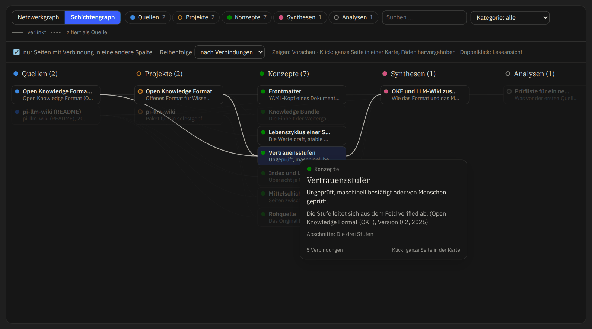

# okfw

Claude-Code-Plugin für Wissens-Wikis, in denen jede Sachaussage belegt ist. Du gibst Quellen hinein, Claude schreibt daraus Karten,
und ein Mensch gibt sie frei. Gelesen, bearbeitet und vorgetragen wird im Dashboard; weitergeben lässt es sich als eine einzelne
HTML-Datei.

okfw steht für Open Knowledge Format Wiki: Markdown-Karten im [Open Knowledge Format v0.2](https://github.com/GoogleCloudPlatform/knowledge-catalog/blob/a8291a1a656669b8766fd4ff0f985505fb955e94/okf/SPEC.md),
gepflegt nach dem LLM-Wiki-Muster von [pi-llm-wiki](https://github.com/zosmaai/pi-llm-wiki).


- **Quellen finden und lesen:** `/okfw:recherche` sucht über offizielle Literatur-APIs. `/okfw:lesen` wertet einen Volltext aus und prüft jeden wörtlichen Anker am Original.
- **Im Dashboard arbeiten:** Graph, Pfade zum Lesen und Vortragen, Glossar und Leseansicht mit Belegen. `okfw.py serve` ergänzt Bearbeiten, Freigabe und Einstellungen.
- **Ein Modell schlägt vor, du entscheidest:** Gespeichert wird erst beim Annehmen, und das Modell bleibt an der Seite vermerkt.
- **Modelle frei wählbar:** Je Arbeit wählst du Weg, Anbieter und Modell. Ohne Einrichtung läuft alles über deine Claude-Code-Anmeldung.




Die Bilder zeigen ein Beispiel-Wiki aus Auszügen amtlicher EU-Texte und sind keine Rechtsberatung. Der Vorschlag im letzten Bild ist
ein fester Text aus dem Aufnahmeskript, keine Antwort eines Modells.

## Zweckbestimmung

okfw ist ein allgemeines Werkzeug, um Wissen aus Quellen zu sammeln, zu belegen und zu prüfen. Es ist nicht dazu bestimmt,
Krankheiten zu erkennen, zu überwachen, zu behandeln oder ihnen vorzubeugen, und gibt keine Empfehlungen für einzelne
Personen. Es ist kein Medizinprodukt. Wer es anders einsetzt, trägt die Verantwortung dafür selbst.

## Installation

Du brauchst [Claude Code](https://code.claude.com/docs) und [uv](https://docs.astral.sh/uv/).

```bash
claude plugin marketplace add sina-769/okfw
claude plugin install okfw@okfw
```

Danach Claude Code neu starten oder `/reload-plugins` aufrufen.

## Loslegen

Bitte Claude Code einfach um Wiki-Arbeit; der Skill kennt die Befehle. Das Dashboard startest du im Projektordner so:

```bash
OKF=$(ls -d ~/.claude/plugins/cache/okfw/okfw/*/skills/okfw | tail -1)/okfw.py
uv run --no-config --quiet "$OKF" init --profile default
uv run --no-config --quiet "$OKF" serve
```

## Mehr

- [Rundgang](docs/rundgang.md): alle Funktionen mit Bildern, Modelle und Anbieter, Freigabe, Arbeit von Hand.
- [Konfiguration](skills/okfw/docs/konfiguration.md): alle Befehle und `wiki.toml`-Schlüssel.
- [Entwicklung](docs/entwicklung.md): Voraussetzungen, Installation ohne Marketplace, Tests, Nachbau, Release.
- [Mitarbeiten](CONTRIBUTING.md): wohin ein Pull Request geht, was er braucht und wie er zurückkommt.
- [CHANGELOG.md](CHANGELOG.md): was sich je Version ändert.

## Lizenz und Dank

okfw steht unter der [MIT-Lizenz](LICENSE). Ausgenommen sind die mitgelieferten Schriften und der
Zitierstil mit eigener Lizenz; sie und die Vorbilder nennt [NOTICE.md](NOTICE.md).
