# okfw

Claude-Code-Plugin für Wissens-Wikis im [Open Knowledge Format v0.2](https://github.com/GoogleCloudPlatform/knowledge-catalog/blob/a8291a1a656669b8766fd4ff0f985505fb955e94/okf/SPEC.md)
(OKF), gepflegt nach dem LLM-Wiki-Muster von [pi-llm-wiki](https://github.com/zosmaai/pi-llm-wiki):
Markdown-Karten mit YAML-Frontmatter, unveränderliche Rohquellen, ein Ereignisprotokoll, generierte Indexe,
Belegpflicht für jede Sachaussage und ein HTML-Dashboard zum Lesen und Lernen.
okfw steht für Open Knowledge Format Wiki; OKF ist das Open Knowledge Format v0.2 (GoogleCloudPlatform/knowledge-catalog).

- **Skill** `okfw`: Arbeitsweise für Claude (Recall → Capture → Ingest → Retro → Lint), Beleg-,
  Lizenz- und Vertrauensregeln.
- **Kern** `skills/okfw/okfw.py`: CLI und Python-Bibliothek (`init`, `capture`, `new`, `body`,
  `sources`, `rebuild`, `lint`, `verify`, `lizenz`, `rechte`, `dashboard` …). Alles Projektspezifische steht in
  einer `wiki.toml` im Projekt; ohne `wiki.toml` schreibt der Kern nichts.
- **Hooks**: Status beim Sitzungsstart, Schreibschutz für Rohquellen, Ereignisprotokoll und generierte
  Dateien sowie für `status` und `verified` auf Wiki-Seiten, Ereignisse und `generated` bei Write/Edit, Rebuild beim Stop, Lint-Fehler gehen dabei an die Sitzung zurück. Sie wirken nur in Projekten mit
  `wiki.toml`.
- **Dashboard**: eine einzelne HTML-Datei ohne Nachladen aus dem Netz (Netzgraph, Lernpfad, Glossar,
  offene Stellen, Leseansicht mit Belegen und Literatur nach APA 7). `okfw.py serve` zeigt es lokal mit Bearbeiten,
  Freigabe und Einstellungen.
- **Skill `recherche`** (`/okfw:recherche <frage>`): Suchplan, offizielle Literatur-APIs mit Protokoll je Abruf, Kandidaten
  ohne Dubletten, Aufnahme mit Rückzugsprüfung, Fundweg und Lizenz. ToolUniverse und Websuche im Container sind optional.
- **Skill `lesen`** (`/okfw:lesen <slug>`): Rechte prüfen, Volltext auswerten lassen, jeden wörtlichen Anker am Original
  prüfen, Karte schreiben, von einem frischen Prüfer gegenprüfen lassen. `/okfw:lesen --pruefen <seite>…` prüft allein.
- **Skill `web-zugriff`**: Regeln für Webseiten ohne API und der Abruf im Container mit Freigabe je Domain.
- **Modellrollen**: je Arbeit wählbar, welcher Harness, Anbieter und welches Modell sie erledigt ([unten](#modelle-und-anbieter)).

Als Plugin heißen die Skills mit Namensraum (`/okfw:recherche`, `/okfw:lesen`); als Skill-Ordner ohne Plugin gilt `/recherche`
und `/lesen`, die Skill-Texte nennen diese kurze Form. Die Texte von Skill und Dokumentation sind deutsch. Was sich je Version
ändert: [CHANGELOG.md](CHANGELOG.md).

## Zweckbestimmung

okfw ist ein allgemeines Werkzeug, um Wissen aus Quellen zu sammeln, zu belegen und zu prüfen. Es ist nicht dazu bestimmt,
Krankheiten zu erkennen, zu überwachen, zu behandeln oder ihnen vorzubeugen, und gibt keine Empfehlungen für einzelne
Personen. Es ist kein Medizinprodukt. Wer es anders einsetzt, trägt die Verantwortung dafür selbst.

## Dashboard

Alle Bilder zeigen ein Beispiel-Wiki aus der [OKF-Spezifikation](https://github.com/GoogleCloudPlatform/knowledge-catalog/blob/a8291a1a656669b8766fd4ff0f985505fb955e94/okf/SPEC.md)
(Apache-2.0) und dem README von [pi-llm-wiki](https://github.com/zosmaai/pi-llm-wiki) (MIT), aufgenommen in einem
Container ohne Netz.

Startansicht mit Kennzahlen, dem Lernpfad und dem Netzwerkgraphen aller Seiten:

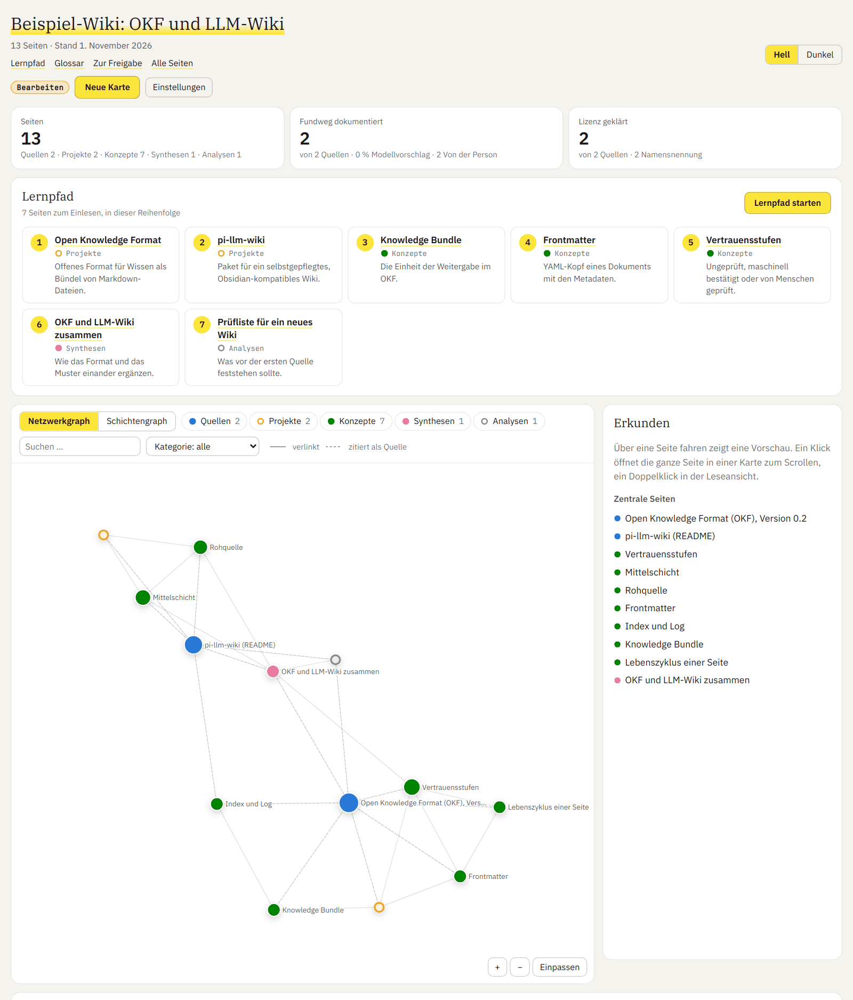

Schichtengraph in dunkler Darstellung, von den Quellen bis zu den Analysen, mit den Verbindungen als Fäden:

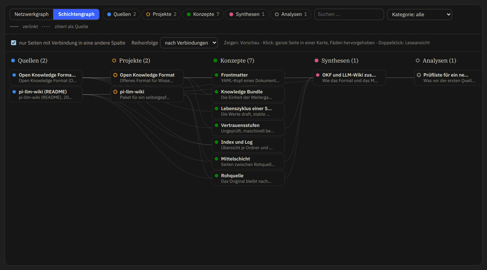

Zeigen öffnet eine Vorschau der Seite und hebt ihre Verbindungen hervor, ein Klick heftet die ganze Seite als Karte an:


Quellenkarte in der Leseansicht mit Fundweg, Nutzungsrechten, APA-Angabe zum Kopieren und RIS-Export:

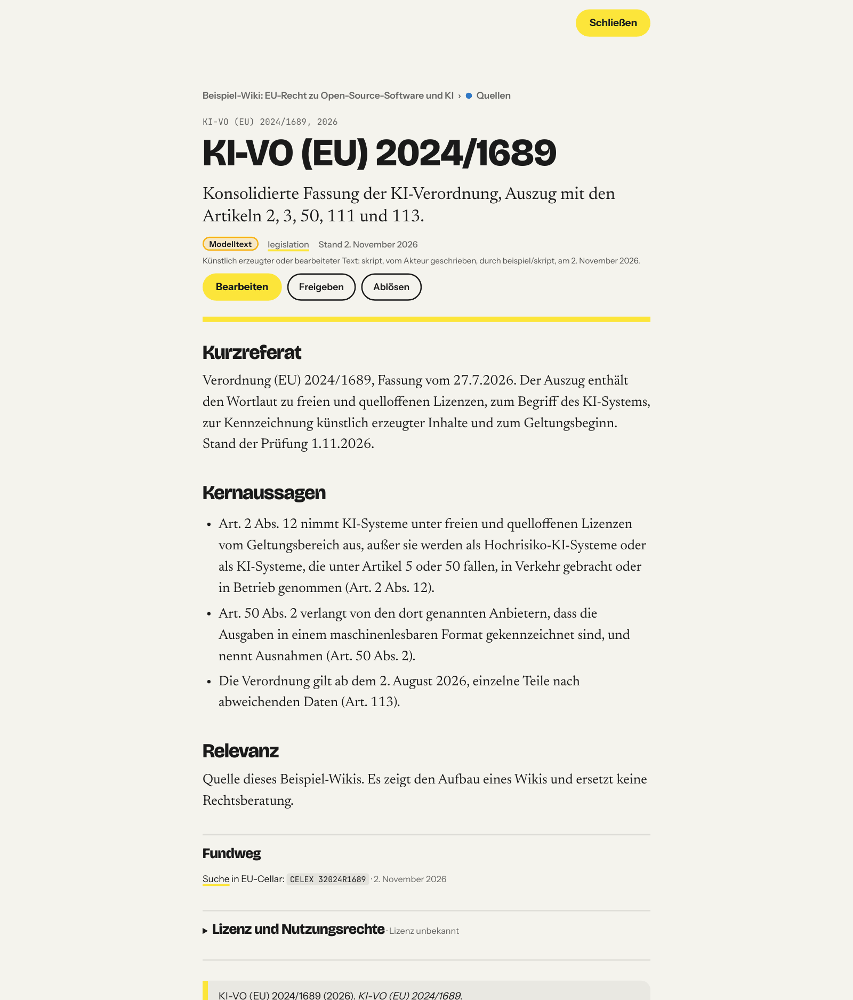

### Bearbeiten im Dashboard

Mit `okfw.py serve` lässt sich jede Karte im Browser bearbeiten, von Hand oder per Prompt. Der Reiter Inhalt zeigt das
Markdown der Seite:

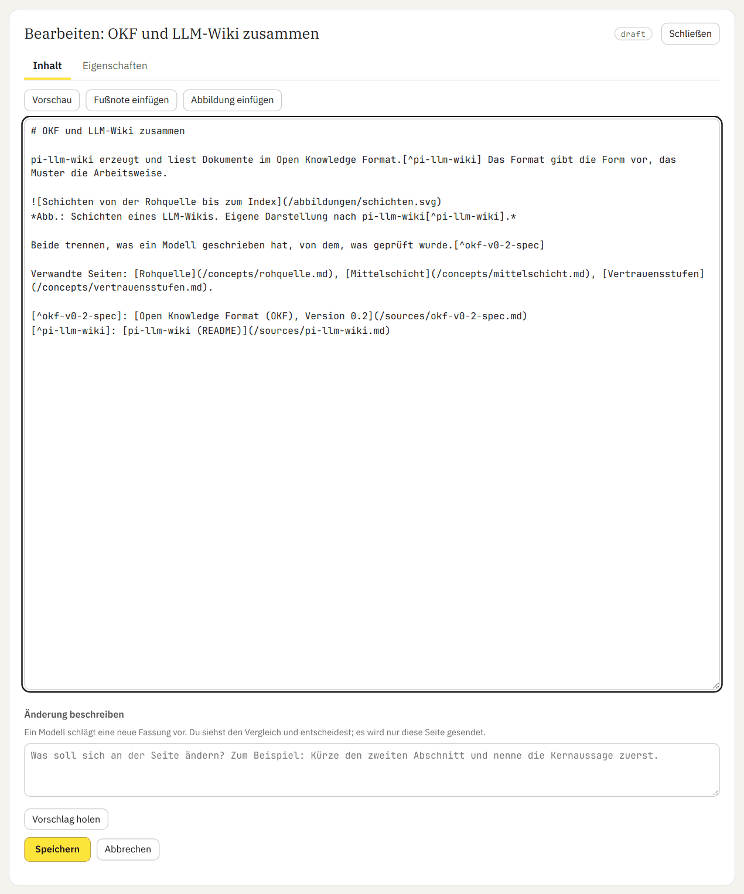

Die Vorschau zeigt den ungespeicherten Text mit aufgelösten Fußnoten und Links:

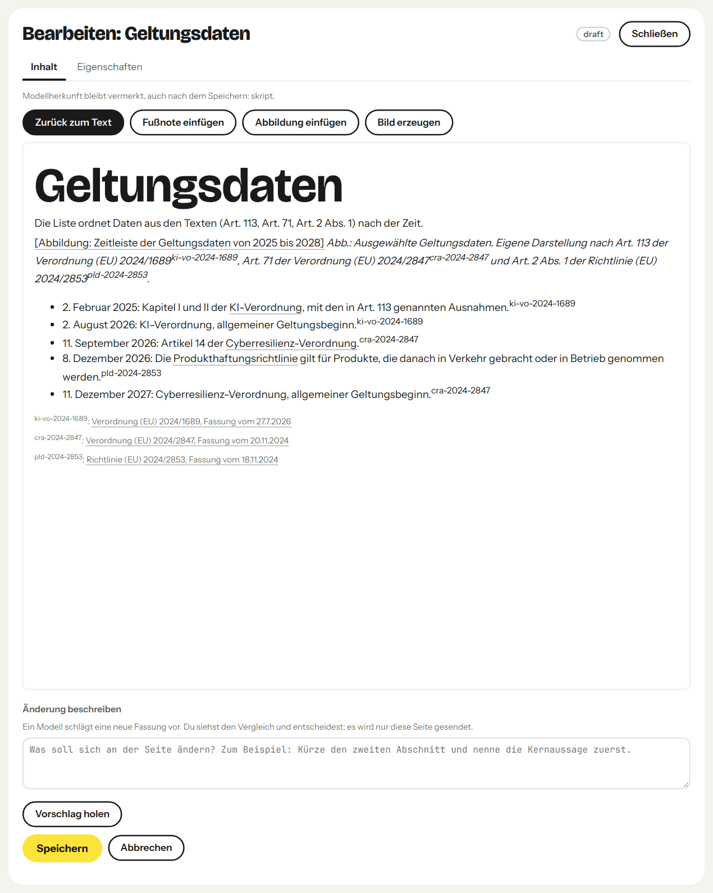

Eine Fußnote wählt die Quelle aus den `sources` der Seite und nimmt die Fundstelle auf:

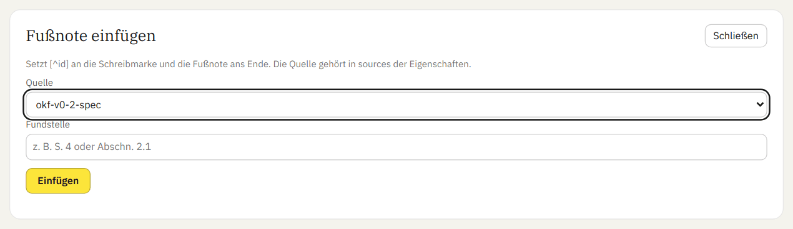

Eine Abbildung kommt als SVG; der Kern prüft und bereinigt sie und legt sie unter `abbildungen/` ab:

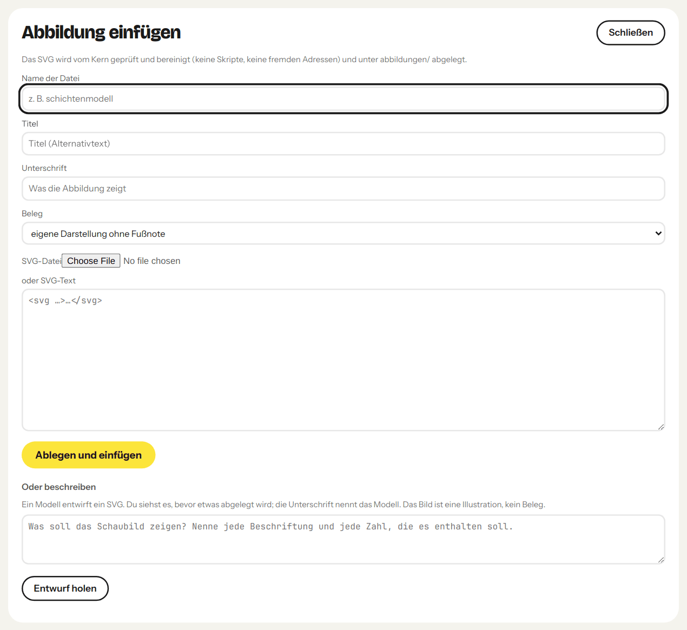

Der Reiter Eigenschaften zeigt das Frontmatter als Felder; geschützte Felder ändert nur der Kern:

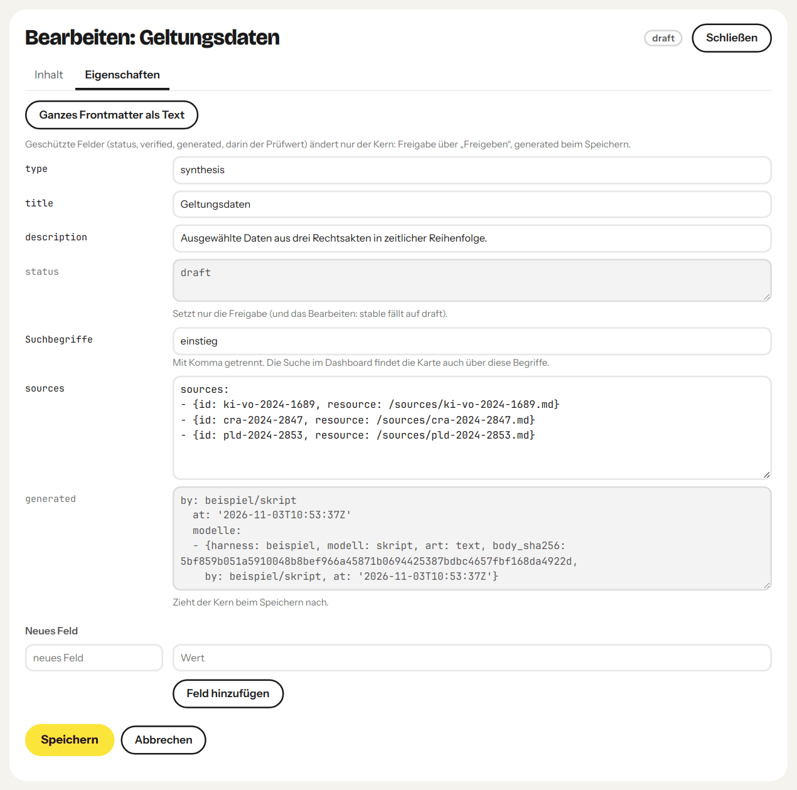

Vor einem Vorschlag sagt das Dashboard, was wohin geht:

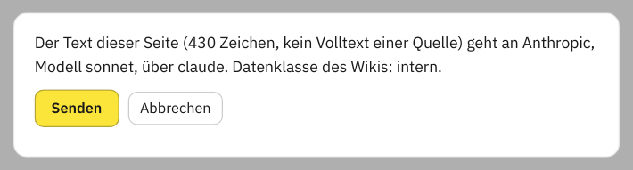

Den Vorschlag siehst du erst als Vergleich und entscheidest dann; gespeichert ist bis dahin nichts. Der Vorschlag im Bild
ist ein fester Text aus dem Aufnahmeskript, keine Antwort eines Modells:

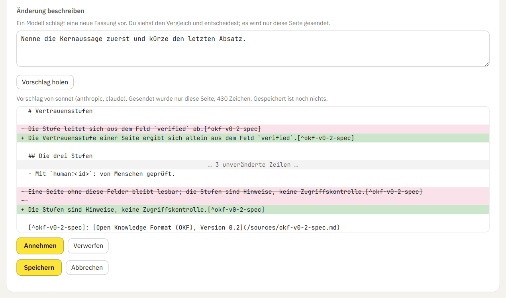

Eine neue Karte legt das Dashboard an wie der Befehl `new`:

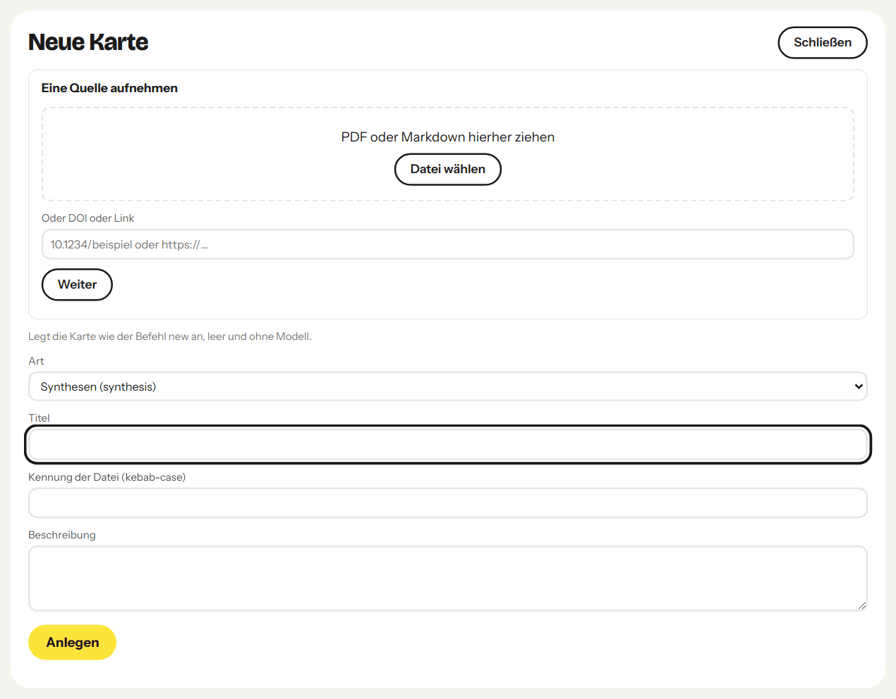

## Modelle und Anbieter

Vier Arbeiten haben eine Rolle: `lesen`, `gegenpruefen`, `bearbeiten` (Vorschlag per Prompt im Dashboard) und `webabruf`.
Je Rolle wählst du drei Dinge, im Dashboard unter *Einstellungen* oder mit `rollen.py setze`:

- **Harness**, der Weg: `sitzung` (die laufende Claude-Code-Sitzung als Subagent), `claude` (`claude -p`), `opencode`
  (`opencode run`), `direkt` (ein HTTP-Aufruf ohne Harness), `container` (nur Webabruf).
- **Anbieter**, die Abrechnung: ab Werk Anthropic, OpenAI, OpenRouter und Ollama, dazu jeder Dienst mit OpenAI- oder
  Anthropic-kompatibler Schnittstelle als *eigener Endpunkt* (Name, Adresse, Name des Schlüsselbund-Eintrags).
- **Modell**, das Gehirn: aus der Modellliste des Anbieters oder frei eingetragen.

Ohne Einrichtung läuft alles über deine Claude-Code-Anmeldung. Für einen anderen Dienst legst du ihn als eigenen Endpunkt an,
legst den Key im eigenen Terminal in den Schlüsselbund und wählst ihn bei der Rolle. Worker bekommen keine Werkzeuge, nur den
Auftrag und die genannten Texte. Keys stehen nie in Dateien und nie in der Oberfläche. Mit `[rollen] daten` und `sperre` in der
`wiki.toml` legst du fest, welche Daten dieses Wikis an welche Anbieter gehen dürfen; darum läuft `rollen.py auftrag` nur mit
der `wiki.toml` des Wikis (`--wiki`) und ohne sie nur ausdrücklich mit `--ohne-wiki`, dann gilt die strengste Klasse. Einzelheiten:
[Modellrollen in konfiguration.md](skills/okfw/docs/konfiguration.md#modellrollen).

Die Rollen in den Einstellungen des Dashboards, ab Werk:

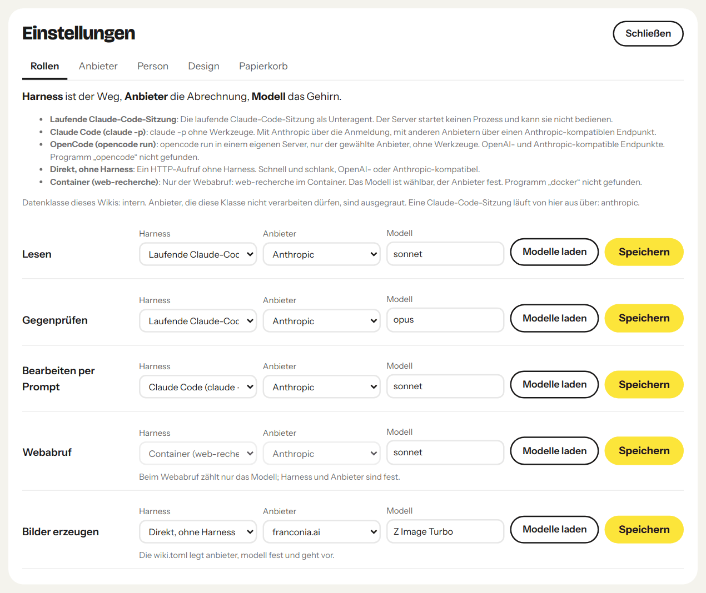

Die Anbieter ab Werk. Die Seite zeigt nur, ob ein Key da ist, und gibt den Befehl zum Ablegen im eigenen Terminal:

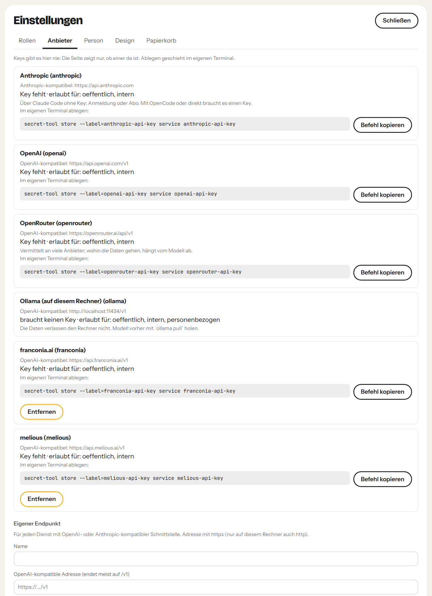

Im Container der Aufnahme fehlen `docker` und `opencode`, darum meldet die Seite sie als nicht gefunden, und die Befehle für
den Schlüsselbund sind die für Linux.

Der Reiter Person legt die Kennung fest, mit der Änderungen und Freigaben aus dem Dashboard vermerkt werden:

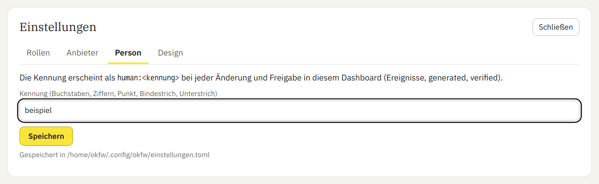

## Voraussetzungen

| Was | Version im Nachbau-Test | Wozu |
|---|---|---|
| [Claude Code](https://code.claude.com/docs) | 2.1.291 | Plugin, Skill, Hooks |
| [uv](https://docs.astral.sh/uv/) | 0.12.7 | startet Kern und Hooks; holt Python ≥ 3.11 und die Pakete aus dem Skriptkopf (PEP 723) |
| Python | ≥ 3.11 (im Test 3.14.7, von uv geholt) | Kern und Hooks; der Kern setzt uv voraus, uv holt ein passendes Python selbst, falls keins da ist |
| PyYAML ≥ 6.0, Markdown ≥ 3.5 | von uv beim ersten Start geholt | Frontmatter, Leseansicht |
| [OpenCode](https://opencode.ai), Docker-Laufzeit | optional | Harness `opencode`; Webabruf im Container |

Netz braucht der Kern beim ersten Start (PyPI, ggf. Python-Download durch uv) und sonst nur in Befehlen,
die dafür da sind: `new source --doi/--pmid/--arxiv`, `lizenz --fetch` und die Skripte von `recherche` (Crossref, PubMed,
Europe PMC, DataCite, OpenAlex, Semantic Scholar, arXiv, EU-Cellar); Modellaufrufe gehen nur an die Anbieter deiner Rollen.
Die Tests laufen unter Linux (GitHub Actions) und macOS, der Nachbau-Test in einem Debian-12-Container.

## Installation

```bash
claude plugin marketplace add sina-769/okfw
claude plugin install okfw@okfw
```

Statt `sina-769/okfw` geht auch ein lokaler Ordner: ein Klon des Repos oder ein Ordner mit
`.claude-plugin/marketplace.json`. Danach Claude Code neu starten (oder `/reload-plugins`).

Ohne Plugin geht es auch als Skill-Ordner: die Ordner unter `skills/` nach `~/.claude/skills/` kopieren, `agents/` nach
`~/.claude/agents/` und `skills/okfw/hooks/settings.example.json` in die `.claude/settings.json` des Projekts übernehmen.
Nicht beides zugleich, sonst laufen die Hooks doppelt.

Was nur für eine Installation gilt (Projekte, Begleit-Skills), steht in einer `local.md` neben
`skills/okfw/SKILL.md`; Vorlage ist [skills/okfw/local.example.md](skills/okfw/local.example.md).

## Erste Schritte

Im Projektordner (Pfad zum Kern aus der Plugin-Installation):

```bash
OKF=$(ls -d ~/.claude/plugins/cache/okfw/okfw/*/skills/okfw | tail -1)/okfw.py
uv run --no-config --quiet "$OKF" init --profile default        # wiki.toml und wiki/ anlegen
uv run --no-config --quiet "$OKF" capture <slug> --url URL --file PFAD --license NAME --license-url URL
uv run --no-config --quiet "$OKF" new source <slug> --title … --description … --resource <url> --access fulltext --set raw_packet=raw/<slug>
                                                    # übernimmt die Lizenz aus dem Manifest
uv run --no-config --quiet "$OKF" new concept <slug> --title … --description … --sources <quelle>
uv run --no-config --quiet "$OKF" body concepts/<slug> text.md  # Inhalt setzen, Fußnoten [^<quelle>]
uv run --no-config --quiet "$OKF" sources concepts/<slug> --add <quelle2>   # Quelle nachtragen
uv run --no-config --quiet "$OKF" rebuild && uv run --no-config --quiet "$OKF" lint
uv run --no-config --quiet "$OKF" dashboard                     # build/wiki-dashboard.html
```

Für ein Wiki über Projektdoku und Code gibt es `init --profile dokumentation`: Quellen mit den Unterarten
Dokumentation, Code, Spezifikation und Datensatz, Lizenz und Rohquellen-Paket als Pflicht, fehlender
Fundweg als Warnung. Dateien aus einem Repo erfasst `capture <slug> --url … --commit SHA --file PFAD=REPO-PFAD`
mit dem Pfad im Repo je Datei.

`capture --license` prüft vorher, ob die Lizenz das lokale Ablegen des Volltexts erlaubt.

Oder in Claude Code einfach um Wiki-Arbeit bitten; der Skill kennt die Befehle. Alle Befehle und
`wiki.toml`-Schlüssel: [skills/okfw/docs/konfiguration.md](skills/okfw/docs/konfiguration.md).

## Freigabe

Jeder Prüfvermerk von `verify` trägt einen Prüfwert des Seitentexts, und ändert sich der Text danach,
verfällt der Vermerk. `status: stable` setzt nur ein Mensch mit `verify <seite>… --by human:<id> --status stable`,
und nur, wenn Claude oder ein Prozess denselben Text vorher gegengeprüft hat; `--force` gibt auch ohne Gegenprüfung frei und vermerkt das im Ereignis. Im Dashboard listet
„Zur Freigabe“ diese Seiten mit ihrem ganzen Text und baut den `verify`-Aufruf für eine ganze Charge zum
Kopieren. Wird eine freigegebene Seite danach mit `body`, Edit oder Write geändert, fällt sie auf `draft`
zurück, und Lint meldet `verified_outdated`. Der Guard sperrt `status` und `verified` nur für die
Schreibwerkzeuge von Claude; ein Prozess mit Shell, auch eine Sitzung mit Bash, kann die Datei trotzdem
ändern und einen `human:`-Vermerk schreiben. Erst `[trust] signed_human = true` bindet eine Freigabe an
eine Signatur, die Claude nicht leisten kann; wer Freigaben als Beleg braucht, schaltet das ein — `signed_human` ist
eine Lint-Regel, kein Guard, und lässt sich mit `human_unsigned = off` abschalten; die Signatur schützt nur, solange
Schlüssel und Passphrase der Sitzung nicht zugänglich sind. Ablauf,
Lint-Regeln und Commit-Signatur:
[„Freigabe über Claude“ in konfiguration.md](skills/okfw/docs/konfiguration.md#freigabe-über-claude).

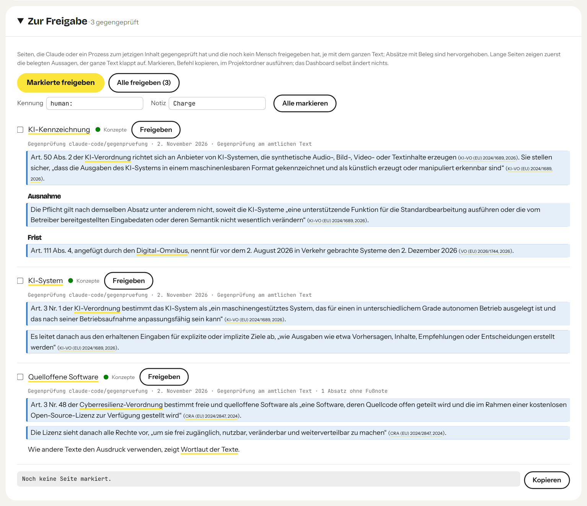

## Release-Schritte

Die Tests laufen bei jedem Pull Request auf GitHub ([.github/workflows/tests.yml](.github/workflows/tests.yml)). Vor
jeder Version:

1. **Prüfen:** alle Testmodule und die Tests der Anwendungen auf der
   [festen Schnittstelle](skills/okfw/docs/konfiguration.md#feste-schnittstelle). Weiter nur bei Grün.
2. **Diff prüfen:** Der Diff seit dem letzten Release wird in Pakete bis 60.000 Zeichen zerlegt, jedes mit dem
   [Angreifermodell](tests/angreifer.md). Ein Modell, das nicht gebaut hat, liest jedes Paket einmal als Code-Review
   und Angriff, Ausgabe live ab Start, 15 Minuten Zeitlimit. Nach einer Zeitüberschreitung wird das Paket nicht
   wiederholt, sondern geteilt oder im Bericht als nicht geprüft geführt.
3. **Korrigieren:** Vor dem Release behoben wird, was im Angreifermodell mit einem Versuch belegt ist, und ein
   nachgestellter Datenverlust oder Bruch der festen Schnittstelle. Alles andere geht in die nächste Version.
   Höchstens zwei Korrekturrunden; jede prüft nur ihren eigenen Diff, kein weiteres
   Modell liest denselben Stand. Bleibt danach ein Befund der ersten Art, entscheidet die Person, ob das Release
   wartet. Bericht als Anhang am Release: behoben, verworfen mit Grund, zurückgestellt, nicht geprüft.
4. **Screenshots:** Die Bilder in `docs/` entstehen neu, nur vor einem Release. Die Aufnahme läuft in einem Container ohne
   Netz, der nur das Plugin und ein Beispiel-Wiki aus öffentlichen Quellen sieht. Vor jedem Bild wird der Seitentext auf
   private Pfade und Namen geprüft, danach der Text im Bild per OCR; ein Treffer bricht den Lauf ab. Die Bilder tragen
   keine Metadaten, und eine Person sieht jedes an, bevor es veröffentlicht wird.
5. **Nachbau:** frische Installation im Container ([Nachbau-Test](#nachbau-test)), Protokoll als
   Anhang am Release.
6. **Export:** Version in `.claude-plugin/plugin.json` und `.claude-plugin/marketplace.json` setzen, `CHANGELOG.md`
   abschließen. Eine feste Prüfung auf genau diesen Stand samt Commit-Nachricht hinterlegt bei Grün einen Vermerk; ohne
   ihn bricht der Export ab. Eine ausgefallene Prüfung gilt als nicht geprüft, nie als grün. Dann die Version
   veröffentlichen und mit einem Tag markieren.

Eine volle Prüfung des ganzen Kerns samt [Selbstreview](tests/selbstreview.md) ist eine eigene Aufgabe, kein
Release-Schritt. Anlass sind ein neuer Angreifer oder Eingabeweg, ein Umbau des Kerns oder ein Befund, der eine neue
Art von Angriff zeigt. Letzte: 0.6.0, der Bericht hängt am Release.

## Tests

Kern und Hooks haben Python-Tests (unittest, ohne weitere Abhängigkeiten). Sie rufen beides so auf wie
Claude Code, über `uv run --no-config --script`, je in einem frischen Wiki unter `$TMPDIR`. `tests/test_abdeckung.py`
hält Doku und Code zusammen: Jeder Befehl, jede Lint-Regel, jeder Schlüssel der `wiki.toml` und jeder Hook steht in der
Doku und wird von einem Test berührt, und was die Doku nennt, gibt es im Code.

```bash
uv run --with pyyaml --with markdown python -m unittest        # im Plugin-Ordner
```

## Nachbau-Test

[tests/nachbau.sh](tests/nachbau.sh) installiert das Plugin in einer frischen Umgebung aus einem
Marketplace, legt ein Demo-Wiki aus zwei frei lizenzierten Quellen an (OKF-Spezifikation, Apache-2.0;
README von pi-llm-wiki, MIT; beide über die GitHub-API auf einen Commit gepinnt und per SHA-256
geprüft), erfasst sie, schreibt Karten, führt `rebuild`, `lint` und `dashboard` aus und ruft die Hooks
mit genau den Befehlen aus `hooks/hooks.json` auf. Dazu kommen der Inhalt des Plugins, `rollen.py` und `api.py` ohne
Einrichtung, die Bereinigung einer SVG-Abbildung, das Dashboard einer Seite mit `{: …}` (kein `onclick`, CSP mit Nonce) und
`okfw serve` (Pfadpräfix, Token, Cookie, fremde Pfade 404). Jeder Schritt landet mit Befehl, Ausgabe und Exit-Code in einem
Protokoll.

```bash
docker build -t okfw-nachbau -f tests/Dockerfile tests
docker run --rm -v "$PWD:/src:ro" -v "$PWD/.nachbau:/out" okfw-nachbau /src /out/lauf-$(date +%H%M%S)
```

Mit `-e CLAUDE_CODE_OAUTH_TOKEN` (Token aus `claude setup-token`) läuft zusätzlich eine echte
Claude-Sitzung, die an den Schreibschutz stößt. Für einen Release gehört sie dazu: Ohne Token steht der Schritt als übersprungen
im Protokoll, und das Protokoll trägt den Vermerk „Unvollständig“.

Letztes Protokoll: okfw 0.6.0, 46 von 46 mit `claude -p`. Die Protokolle hängen an den Releases.

## Lizenz und Dank

okfw steht unter der [MIT-Lizenz](LICENSE). Ausgenommen sind die mitgelieferten Schriften und der
Zitierstil mit eigener Lizenz; sie und die Vorbilder nennt [NOTICE.md](NOTICE.md).
