# Rundgang durch okfw

Was dazugehört, wie es aussieht und wie du von Hand damit arbeitest. Kurzfassung und Installation: [README](../README.md).

## Was dazugehört

- **Skill** `okfw`: Arbeitsweise für Claude (Recall → Capture → Ingest → Retro → Lint), Beleg-,
  Lizenz- und Vertrauensregeln.
- **Kern** `skills/okfw/okfw.py`: CLI und Python-Bibliothek (`init`, `capture`, `new`, `body`,
  `sources`, `rebuild`, `lint`, `verify`, `lizenz`, `rechte`, `dashboard` …). Alles Projektspezifische steht in
  einer `wiki.toml` im Projekt; ohne `wiki.toml` schreibt der Kern nichts.
- **Hooks**: Status beim Sitzungsstart, Schreibschutz für Rohquellen, Ereignisprotokoll und generierte
  Dateien sowie für `status`, `verified` und `generated.modelle` auf Wiki-Seiten, Ereignisse und `generated` bei Write/Edit, Rebuild beim Stop, Lint-Fehler gehen dabei an die Sitzung zurück. Sie wirken nur in Projekten mit
  `wiki.toml`.
- **Dashboard**: eine einzelne HTML-Datei ohne Nachladen aus dem Netz (Netzgraph, Pfade, Glossar,
  offene Stellen, Leseansicht mit Belegen und Literatur nach APA 7). `okfw.py serve` zeigt es lokal mit Bearbeiten,
  Freigabe und Einstellungen.
- **Skill `recherche`** (`/okfw:recherche <frage>`): Suchplan, offizielle Literatur-APIs mit Protokoll je Abruf, Kandidaten
  ohne Dubletten, Aufnahme mit Rückzugsprüfung, Fundweg und Lizenz. ToolUniverse und Websuche im Container sind optional.
- **Skill `lesen`** (`/okfw:lesen <slug>`): Rechte prüfen, Volltext auswerten lassen, jeden wörtlichen Anker am Original
  prüfen, Karte schreiben, von einem frischen Prüfer gegenprüfen lassen. `/okfw:lesen --pruefen <seite>…` prüft allein.
- **Skill `web-zugriff`**: Regeln für Webseiten ohne API und der Abruf im Container mit Freigabe je Domain.
- **Modellrollen**: je Arbeit wählbar, welcher Harness, Anbieter und welches Modell sie erledigt ([unten](#modelle-und-anbieter)).

Als Plugin heißen die Skills mit Namensraum (`/okfw:recherche`, `/okfw:lesen`); als Skill-Ordner ohne Plugin gilt `/recherche`
und `/lesen`, die Skill-Texte nennen diese kurze Form. Die Texte von Skill und Dokumentation sind deutsch. Was sich je Version
ändert: [CHANGELOG.md](../CHANGELOG.md).

## Dashboard

Alle Bilder zeigen ein Beispiel-Wiki aus Auszügen amtlicher EU-Texte zu Open-Source-Software und KI, Stand 1.11.2026, aufgenommen
in einem Container ohne Netz. Es zeigt nur den Aufbau eines Wikis und ist keine Rechtsberatung: Die Karten geben wieder, was die
Normen sagen, nicht, für wen sie gelten.

Startansicht mit Kennzahlen, den Pfaden und dem Netzwerkgraphen aller Seiten:


Schichtengraph in dunkler Darstellung, von den Quellen bis zu den Analysen, mit den Verbindungen als Fäden:

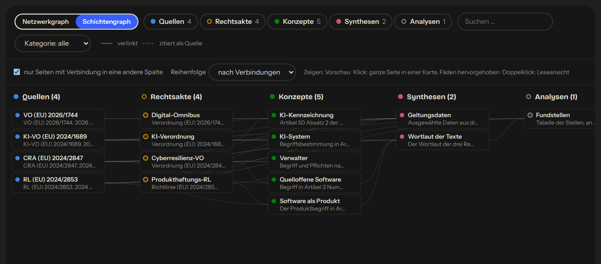

Zeigen öffnet eine Vorschau der Seite und hebt ihre Verbindungen hervor, ein Klick heftet die ganze Seite als Karte an:

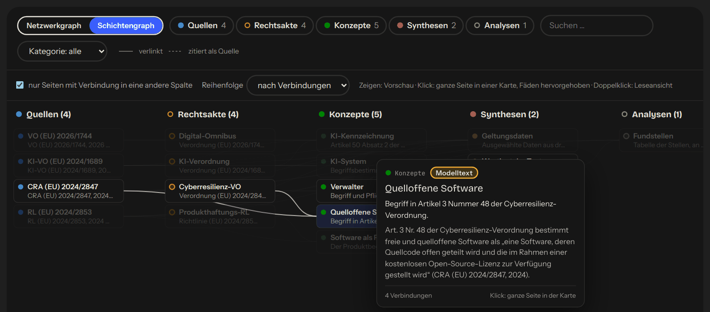

Quellenkarte in der Leseansicht mit Fundweg, Nutzungsrechten, APA-Angabe zum Kopieren und RIS-Export:


### Bearbeiten im Dashboard

Mit `okfw.py serve` lässt sich jede Karte im Browser bearbeiten, von Hand oder per Prompt. Der Reiter Inhalt zeigt das
Markdown der Seite:

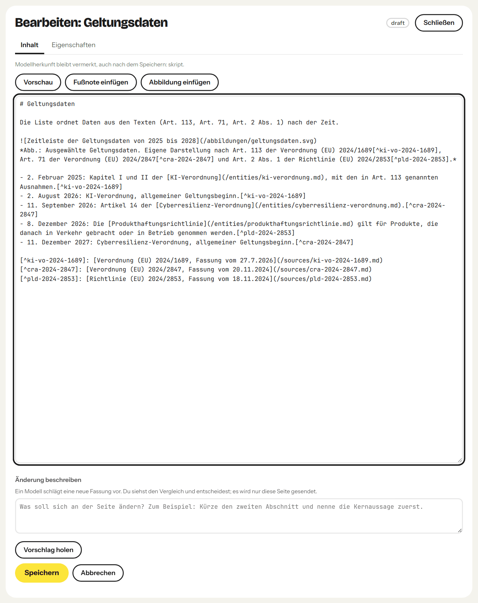

Die Vorschau zeigt den ungespeicherten Text mit aufgelösten Fußnoten und Links:

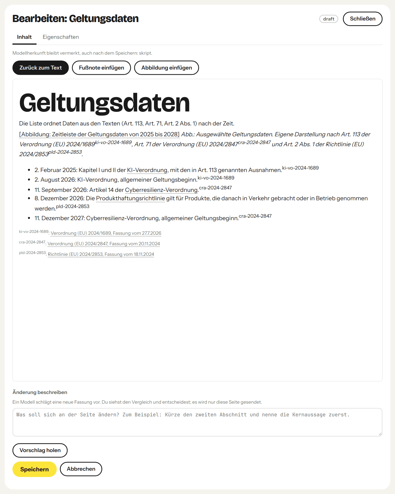

Eine Fußnote wählt die Quelle aus den `sources` der Seite und nimmt die Fundstelle auf:

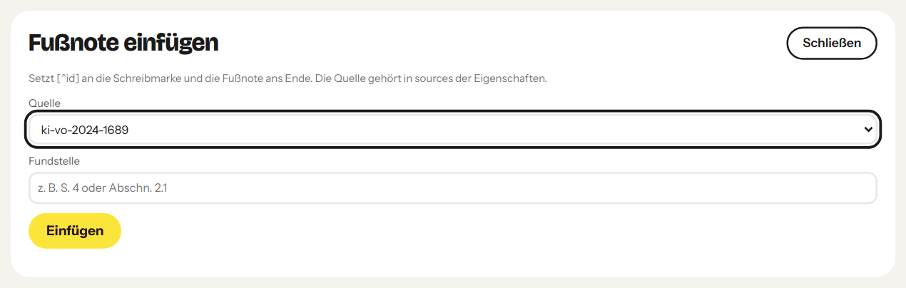

Eine Abbildung kommt als SVG; der Kern prüft und bereinigt sie und legt sie unter `abbildungen/` ab:

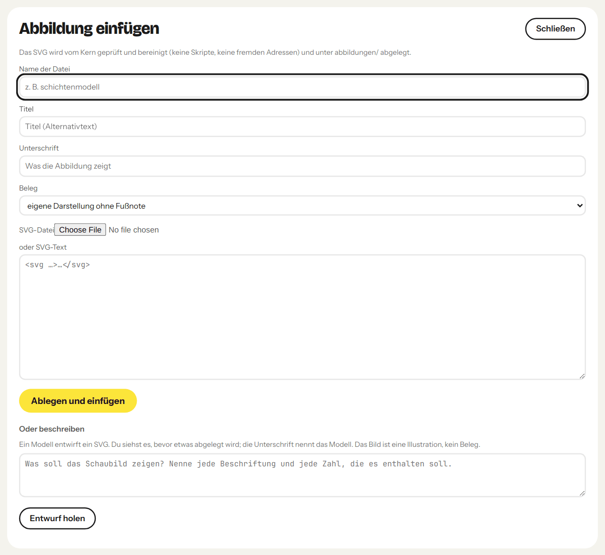

Der Reiter Eigenschaften zeigt das Frontmatter als Felder; geschützte Felder ändert nur der Kern:

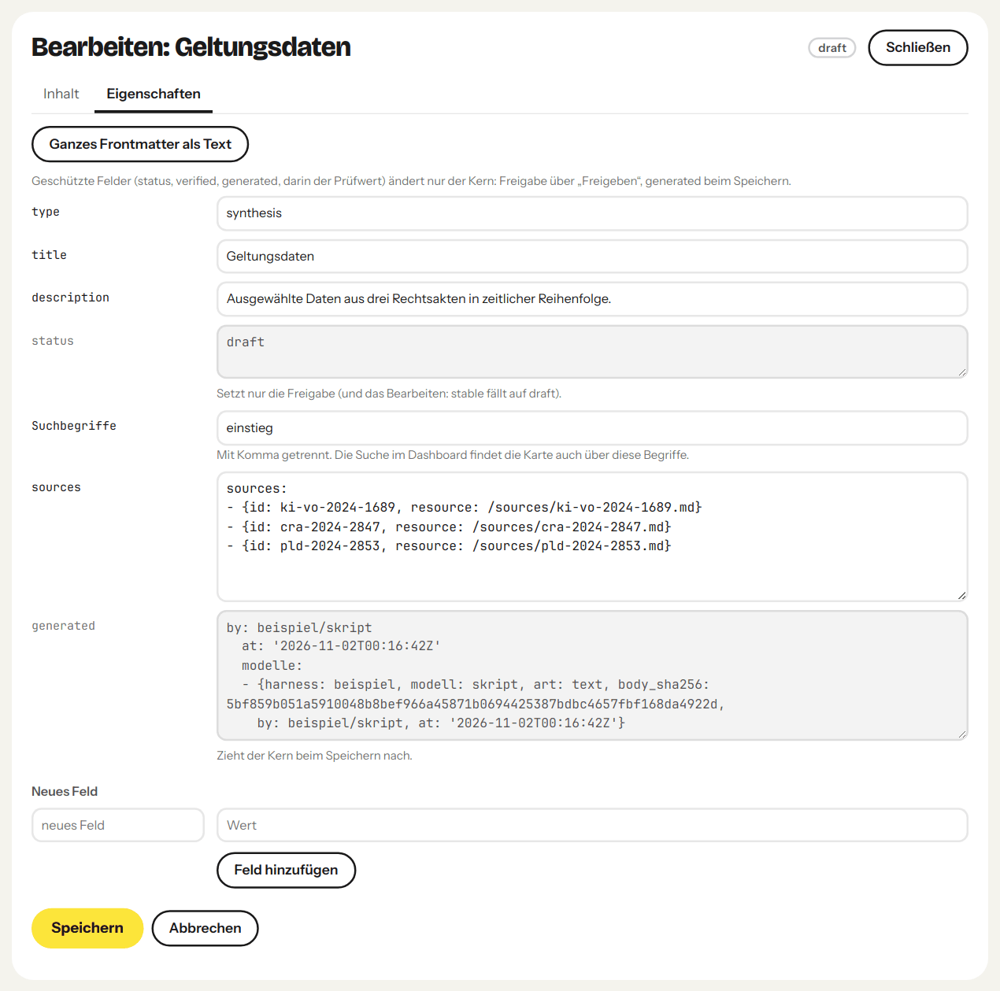

Vor einem Vorschlag sagt das Dashboard, was wohin geht:

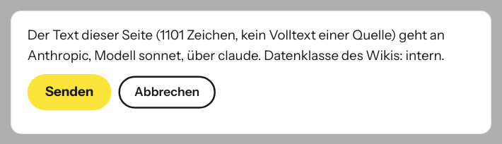

Das Modell arbeitet im Hintergrund: Du kannst weiterarbeiten, die Seite neu laden oder den Auftrag abbrechen. Den Vorschlag siehst du erst als Vergleich und entscheidest dann; gespeichert ist bis dahin nichts. Der Vorschlag im Bild
ist ein fester Text aus dem Aufnahmeskript, keine Antwort eines Modells:

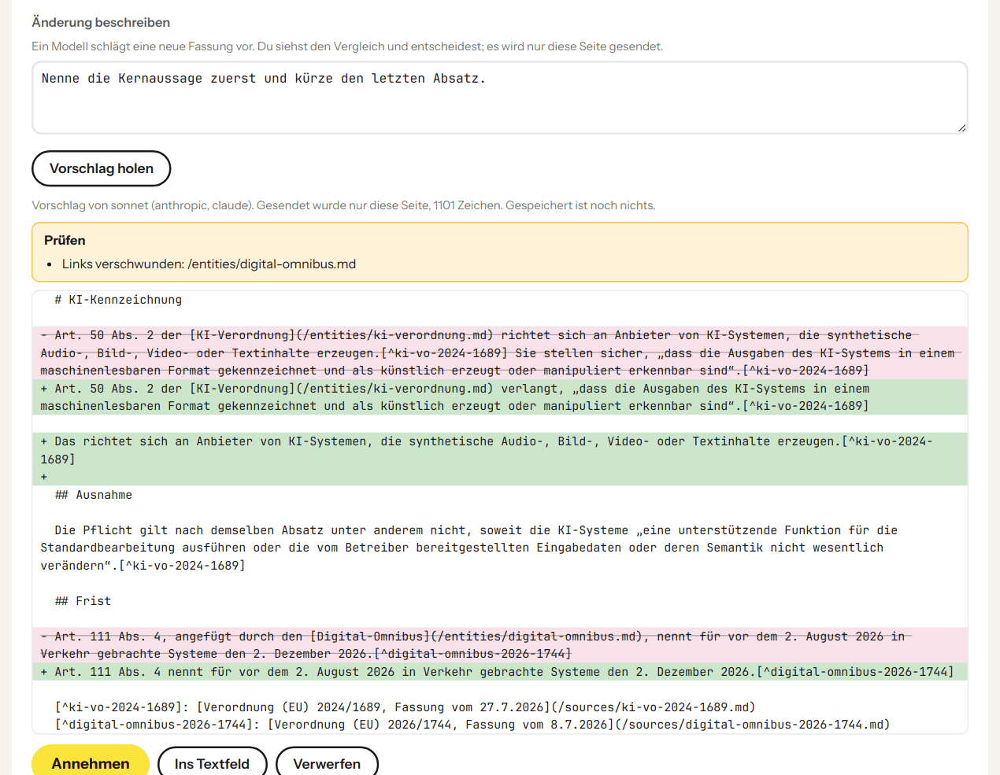

Übernimmst du einen Vorschlag, steht das Modell dauerhaft in `generated.modelle` im Frontmatter, neben deiner Kennung als
der Person, die ihn übernommen hat. Es bleibt nach weiterem Bearbeiten und nach der Freigabe stehen, und das Dashboard zeigt es an
der Seite, auch in der öffentlichen Ausgabe. Das gilt ebenso für Text, den eine Sitzung oder die Rolle `lesen` schreibt
([Modellherkunft](../skills/okfw/docs/konfiguration.md#gemeinsames-frontmatter-profil)). Ob das eine gesetzliche
Kennzeichnungspflicht erfüllt, ist nicht geprüft.

Eine neue Karte legt das Dashboard an wie der Befehl `new`. Ein PDF oder Markdown, auf „Neue Karte“ gezogen, wird nach der Klärung der Rechte zum Vorschlag aus Quellenkarte und Konzeptkarten, die Anker am Original geprüft; angenommen landet alles als Entwurf:

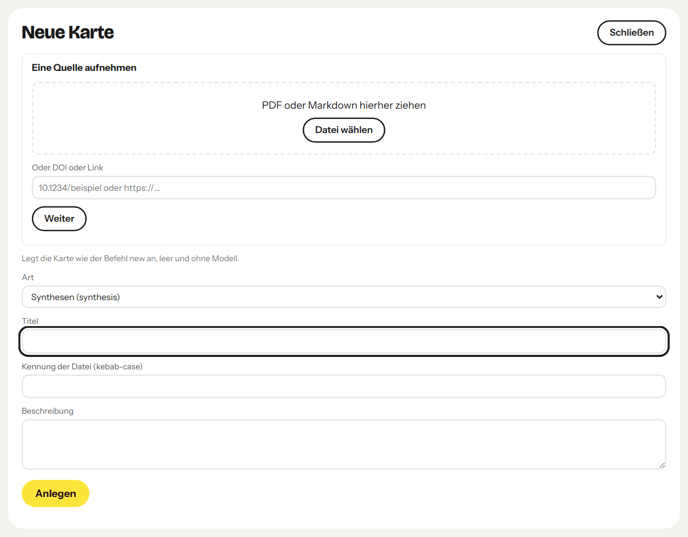

Ein Pfad führt durch ein Wiki: Stationen in fester Folge, jede mit mehreren Karten und eigenem Text auf einer Fläche. Karten werden nur verwiesen und zeigen ihren eigenen Prüfstand, eigener Text bleibt als solcher gekennzeichnet. Derselbe Pfad lässt sich lesen und im Vollbild vortragen, mit Tastatur, Sprechernotizen und Druck je Station; `okfw.py pfad export` schreibt eine Datei mit nur seinen Karten. Frontmatter muss dafür niemand kennen.

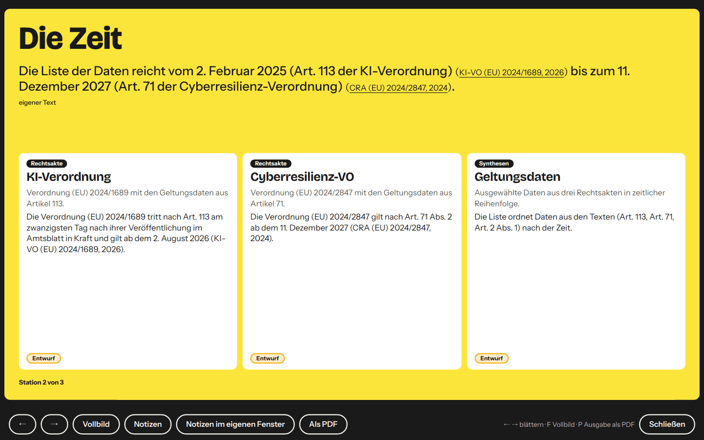

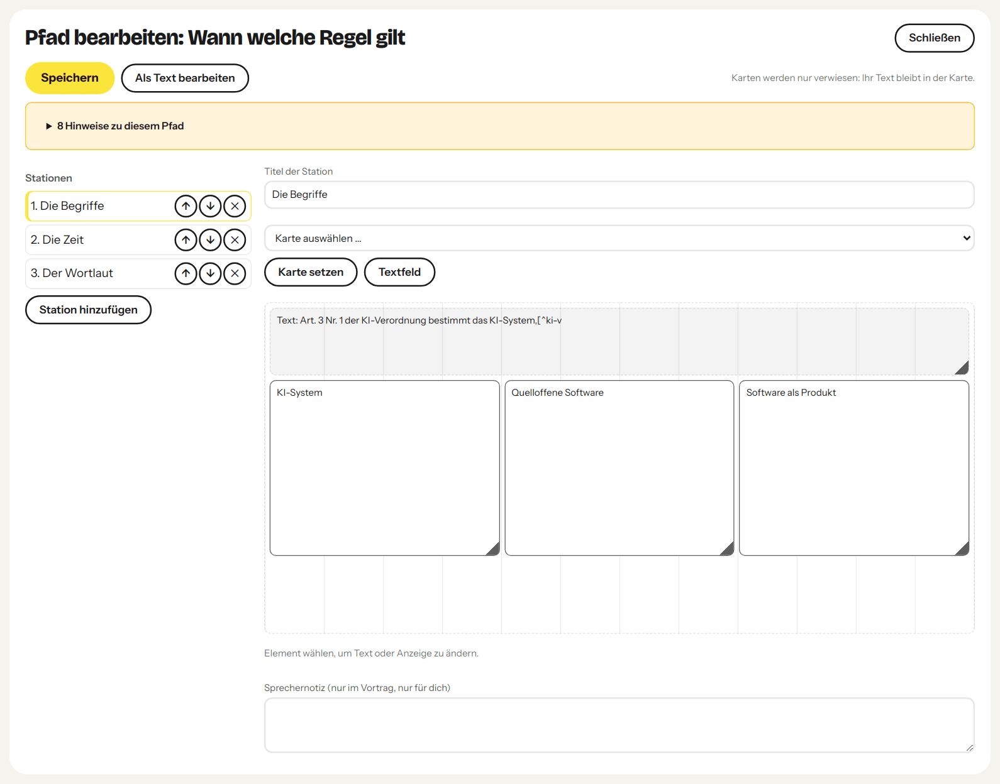

## Modelle und Anbieter

Vier Arbeiten haben eine Rolle: `lesen`, `gegenpruefen`, `bearbeiten` (Vorschlag per Prompt und Schaubild aus einer Beschreibung im Dashboard) und `webabruf`.
Je Rolle wählst du drei Dinge, im Dashboard unter *Einstellungen* oder mit `rollen.py setze`:

- **Harness**, der Weg: `sitzung` (die laufende Claude-Code-Sitzung als Subagent), `claude` (`claude -p`), `opencode`
  (`opencode run`), `direkt` (ein HTTP-Aufruf ohne Harness), `container` (nur Webabruf).
- **Anbieter**, die Abrechnung: ab Werk Anthropic, OpenAI, OpenRouter und Ollama, dazu jeder Dienst mit OpenAI- oder
  Anthropic-kompatibler Schnittstelle als *eigener Endpunkt* (Name, Adresse, Name des Schlüsselbund-Eintrags).
- **Modell**, das Gehirn: aus der Modellliste des Anbieters oder frei eingetragen.

Ohne Einrichtung läuft alles über deine Claude-Code-Anmeldung. Für einen anderen Dienst legst du ihn als eigenen Endpunkt an,
legst den Key im eigenen Terminal in den Schlüsselbund und wählst ihn bei der Rolle. Worker bekommen keine Werkzeuge, nur den
Auftrag und die genannten Texte. Keys stehen nie in Dateien und nie in der Oberfläche. Mit `[rollen] daten` und `sperre` in der
`wiki.toml` legst du fest, welche Daten dieses Wikis an welche Anbieter gehen dürfen; darum läuft `rollen.py auftrag` nur mit
der `wiki.toml` des Wikis (`--wiki`) und ohne sie nur ausdrücklich mit `--ohne-wiki`, dann gilt die strengste Klasse. Einzelheiten:
[Modellrollen in konfiguration.md](../skills/okfw/docs/konfiguration.md#modellrollen).

Die Rollen in den Einstellungen des Dashboards, ab Werk:

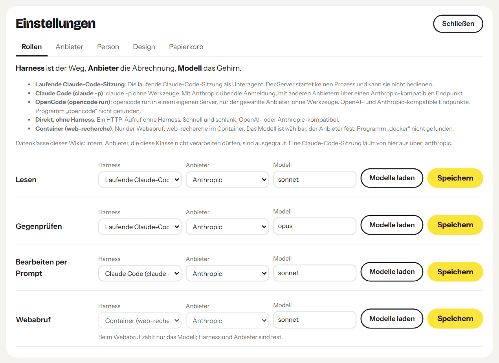

Die Anbieter ab Werk. Die Seite zeigt nur, ob ein Key da ist, und gibt den Befehl zum Ablegen im eigenen Terminal:

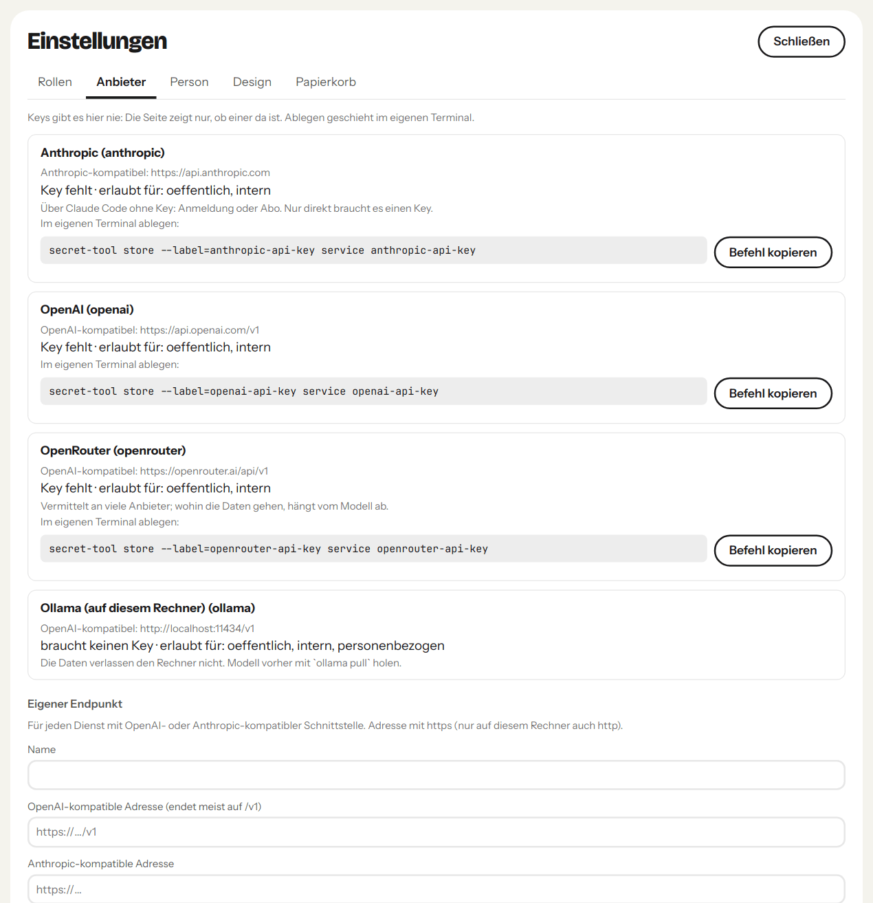

Im Container der Aufnahme fehlen `docker` und `opencode`, darum meldet die Seite sie als nicht gefunden, und die Befehle für
den Schlüsselbund sind die für Linux.

Der Reiter Person legt die Kennung fest, mit der Änderungen und Freigaben aus dem Dashboard vermerkt werden:

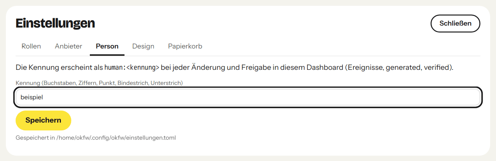

## Freigabe

Jeder Prüfvermerk von `verify` trägt einen Prüfwert des Seitentexts, und ändert sich der Text danach,
verfällt der Vermerk. `status: stable` setzt nur ein Mensch mit `verify <seite>… --by human:<id> --status stable`,
und nur, wenn Claude oder ein Prozess denselben Text vorher gegengeprüft hat; `--force` gibt auch ohne Gegenprüfung frei und vermerkt das im Ereignis. Im Dashboard listet
„Zur Freigabe“ diese Seiten mit ihrem ganzen Text und baut den `verify`-Aufruf für eine ganze Charge zum
Kopieren. Wird eine freigegebene Seite danach mit `body`, Edit oder Write geändert, fällt sie auf `draft`
zurück, und Lint meldet `verified_outdated`. Der Guard sperrt `status` und `verified` nur für die
Schreibwerkzeuge von Claude; ein Prozess mit Shell, auch eine Sitzung mit Bash, kann die Datei trotzdem
ändern und einen `human:`-Vermerk schreiben. Erst `[trust] signed_human = true` bindet eine Freigabe an
eine Signatur, die Claude nicht leisten kann; wer Freigaben als Beleg braucht, schaltet das ein — `signed_human` ist
eine Lint-Regel, kein Guard, und lässt sich mit `human_unsigned = off` abschalten; die Signatur schützt nur, solange
Schlüssel und Passphrase der Sitzung nicht zugänglich sind. Ablauf,
Lint-Regeln und Commit-Signatur:
[„Freigabe über Claude“ in konfiguration.md](../skills/okfw/docs/konfiguration.md#freigabe-über-claude).

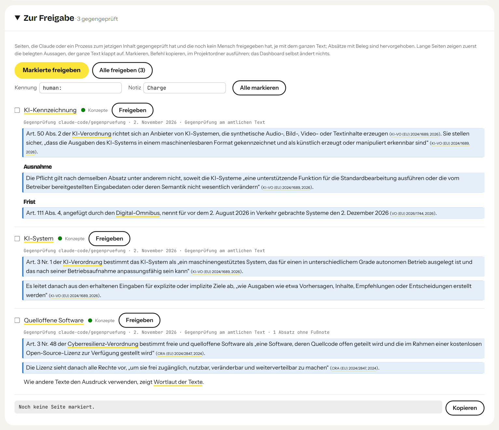

## Von Hand arbeiten

Im Projektordner (Pfad zum Kern aus der Plugin-Installation):

```bash
OKF=$(ls -d ~/.claude/plugins/cache/okfw/okfw/*/skills/okfw | tail -1)/okfw.py
uv run --no-config --quiet "$OKF" init --profile default        # wiki.toml und wiki/ anlegen
uv run --no-config --quiet "$OKF" capture <slug> --url URL --file PFAD --license NAME --license-url URL
uv run --no-config --quiet "$OKF" new source <slug> --title … --description … --resource <url> --access fulltext --set raw_packet=raw/<slug>
                                                    # übernimmt die Lizenz aus dem Manifest
uv run --no-config --quiet "$OKF" new concept <slug> --title … --description … --sources <quelle>
uv run --no-config --quiet "$OKF" body concepts/<slug> text.md  # Inhalt setzen, Fußnoten [^<quelle>]
uv run --no-config --quiet "$OKF" sources concepts/<slug> --add <quelle2>   # Quelle nachtragen
uv run --no-config --quiet "$OKF" rebuild && uv run --no-config --quiet "$OKF" lint
uv run --no-config --quiet "$OKF" dashboard                     # build/wiki-dashboard.html
```

Für ein Wiki über Projektdoku und Code gibt es `init --profile dokumentation`: Quellen mit den Unterarten
Dokumentation, Code, Spezifikation und Datensatz, Lizenz und Rohquellen-Paket als Pflicht, fehlender
Fundweg als Warnung. Dateien aus einem Repo erfasst `capture <slug> --url … --commit SHA --file PFAD=REPO-PFAD`
mit dem Pfad im Repo je Datei.

`capture --license` prüft vorher, ob die Lizenz das lokale Ablegen des Volltexts erlaubt.

Oder in Claude Code einfach um Wiki-Arbeit bitten; der Skill kennt die Befehle. Alle Befehle und
`wiki.toml`-Schlüssel: [skills/okfw/docs/konfiguration.md](../skills/okfw/docs/konfiguration.md).
